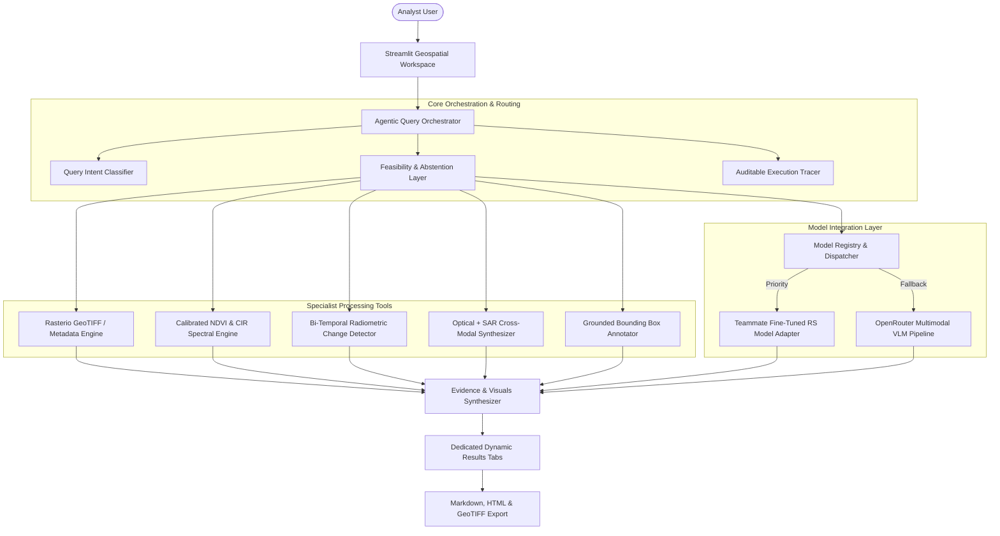

# 🛰️ SatQuery AI

**ST-09 / SIH26167 — ISRO Remote-Sensing Vision-Language Assistant**  
*Interactive Multimodal Earth Observation Intelligence Platform*

[](https://satqueryai-m6yaqyeddyk8lp4z8eg9hm.streamlit.app/)
[](LICENSE)
[](https://www.python.org/downloads/)

SatQuery AI is an evidence-grounded satellite imagery intelligence application that enables natural language dialogues about satellite imagery and returns scientific text explanations accompanied by pixel-level spatial evidence: bounding boxes, calibrated vegetation products, bi-temporal change maps, and joint optical–SAR structural representations.

---

## 🏛️ System Architecture



---

## 🌟 Key Capabilities

### 1. Single-Image Intelligence & Region Grounding
- **Multimodal Visual Question Answering (VQA):** High-precision land-cover descriptions, hydrology detection, and terrain characterization.
- **Text-Guided Region Grounding:** Automated bounding box localization on visual imagery with translucent alpha overlays and class tags.
- **Scene Captioning:** Comprehensive environmental overview of satellite scenes.

### 2. Scientific Spectral & Vegetation Products
- **True Physical NDVI:** Computed via `(NIR - Red) / (NIR + Red)` when genuine physical Near-Infrared and Red bands are present in GeoTIFF inputs.
- **Honest CIR Canopy Proxy:** When standard 3-band RGB imagery is analyzed, the system **never fabricates genuine NDVI**. It clearly reports a calibrated Color-Infrared (CIR) canopy proxy with prominent scientific disclaimers.
- **Hydrology & Soil Absorption:** Water body delineation and bare soil / high-albedo terrain identification.

### 3. Bi-Temporal Change Detection (T1 & T2)
- **Radiometric Delta Mapping:** Computes absolute intensity shifts across co-registered observation dates.
- **Gain vs. Loss Directional Categorization:** Green highlights for expansion/growth; Red highlights for reduction/deforestation.
- **Confounding Factors Evaluation:** Explicitly accounts for seasonal phenology, sun elevation drift, and sub-pixel registration displacement.

### 4. Cross-Modal Optical + SAR Joint Analysis
- **Surface Reflectance + Radar Backscatter:** Combines optical spectral signatures with Synthetic Aperture Radar (SAR) volumetric backscatter and double-bounce corner reflection (urban settlements, maritime structures).
- **Structural-Spectral Composite:** Complementary multi-sensor visualization.

### 5. Auditable Execution Trace & Abstention Layer
- **Every step is audited:** Tool selection, input dimensions, model invocation, and duration in milliseconds.
- **Honest Abstention:** Refuses to guess when temporal pairs or required spectral bands are missing, explaining exact requirements.

---

## 📚 Benchmark Dataset Integration

SatQuery AI incorporates official dataset specifications mandated by problem statement **ST-09 / SIH26167**:

| Dataset | Modalities | Scale | Primary Tasks |
| :--- | :--- | :--- | :--- |
| **BigEarthNet** | Sentinel-2 (MSI) & Sentinel-1 (SAR) | 590,326 pairs | Multi-label Land Cover Classification, Cross-Modal Representation |
| **VRSBench** | High-Res Aerial & Satellite | 102,400+ pairs | Scene Captioning, Visual Grounding (Bboxes), VQA |
| **RSVQA** | Sentinel-2 (LR) & Aerial Orthophotos (HR) | 1,000,000+ QA | Presence/Absence, Object Counting, Comparative VQA |
| **CDVQA** | Bi-Temporal Satellite Pairs | 10,000+ pairs | Change-Based Visual Question Answering, Transition Verification |

---

## 🔌 Teammate Model Integration

Your teammate's fine-tuned model connects directly via our adapter interface:
- **Contract Specification:** Documented in [`docs/TEAMMATE_API_CONTRACT.md`](docs/TEAMMATE_API_CONTRACT.md).
- **Configurable Endpoint:** Via `TEAMMATE_MODEL_API_URL` environment variable or in-app Model Registry UI.
- **Graceful Fallback:** If the custom inference server is offline, SatQuery AI automatically switches to the OpenRouter VLM pipeline while clearly showing connection telemetry.

---

## 🚀 Quickstart & Local Development

### 1. Clone & Setup
```bash
git clone https://github.com/GowthamReddy0808/satqueryai.git
cd satqueryai
python -m venv .venv

# Activate:
# Windows: .venv\Scripts\activate
# Linux/macOS: source .venv/bin/activate

pip install -r requirements.txt
```

### 2. Configure Environment Variables
Copy `.env.example` to `.env`:
```ini
OPENROUTER_API_KEY=your_openrouter_api_key_here
TEAMMATE_MODEL_API_URL=http://localhost:8000
TEAMMATE_MODEL_API_KEY=optional_token
```

### 3. Run Automated Tests
```bash
python -m unittest tests/test_satquery.py
```
*Executes all 10 unit and integration tests covering rasterio GeoTIFF parsing, change detection, optical-SAR, and evaluation metrics.*

### 4. Launch Application
```bash
streamlit run app.py --server.port 8502
```
Access at [http://localhost:8502](http://localhost:8502).

---

## 🌐 Deployment Instructions

### Streamlit Community Cloud
1. Push all code to the `main` branch of `https://github.com/GowthamReddy0808/satqueryai.git`.
2. Connect your repo on [share.streamlit.io](https://share.streamlit.io).
3. Under **Advanced Settings -> Secrets**, set:
   ```toml
   OPENROUTER_API_KEY = "your_key_here"
   TEAMMATE_MODEL_API_URL = "http://your-server-ip:8000"
   ```
4. Click **Deploy**. Redeployments are automated with each git push.

---

## 📄 License
Developed for the National Smart India Hackathon (SIH) under Problem Statement ST-09 / SIH26167. Open source under the MIT License.
