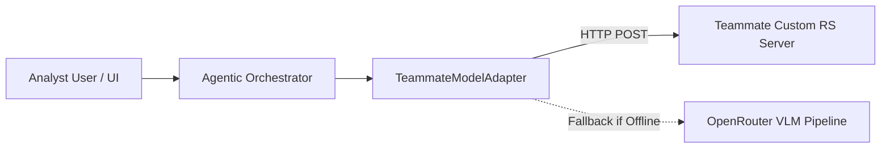

# SatQuery AI — Teammate Model API Integration Contract
**Problem Statement:** ST-09 / SIH26167 — ISRO Remote-Sensing Vision-Language Assistant  
**Interface Specification Version:** 1.0.0  

This document defines the REST/JSON integration contract for connecting the fine-tuned remote-sensing vision-language model developed by your teammate to the SatQuery AI application.

---

## 1. Architecture Overview
SatQuery AI uses a modular adapter architecture (`models/teammate_adapter.py`). When configured, the system routes queries to your teammate's custom inference server. If the server is offline or unreachable, the system automatically falls back to the OpenRouter multi-modal VLM pipeline while clearly indicating the connection state in the UI.



---

## 2. Environment Variables & Authentication

| Environment Variable | Description | Default |
| :--- | :--- | :--- |
| `TEAMMATE_MODEL_API_URL` | Base HTTP(S) URL of your teammate's inference server | `http://localhost:8000` |
| `TEAMMATE_MODEL_API_KEY` | Optional Bearer token or secret API key | `None` |
| `TEAMMATE_MODEL_ID` | Model identifier string | `isro-satquery-rs-v1` |

When `TEAMMATE_MODEL_API_KEY` is set, all requests will include the header:
```http
Authorization: Bearer <TEAMMATE_MODEL_API_KEY>
Content-Type: application/json
```

---

## 3. Endpoints

### 3.1 Health Check Endpoint
- **Path:** `/health`
- **Method:** `GET`
- **Purpose:** SatQuery AI periodically pings this endpoint to verify server availability and report connection status.
- **Expected Response (HTTP 200 OK):**
```json
{
  "status": "healthy",
  "model_id": "isro-satquery-rs-v1",
  "device": "cuda:0",
  "supported_tasks": [
    "visual_question_answering",
    "scene_captioning",
    "region_grounding",
    "object_counting",
    "land_cover_analysis",
    "bi_temporal_change_detection",
    "optical_sar_joint_analysis"
  ]
}
```

---

### 3.2 Inference Endpoint
- **Path:** `/v1/infer`
- **Method:** `POST`
- **Purpose:** Executes remote sensing vision-language inference on single or paired satellite images.

#### Request Schema:
```json
{
  "model": "isro-satquery-rs-v1",
  "task_type": "visual_question_answering",
  "query": "Where is vegetation visible in this image? Explain the spectral colours.",
  "images": [
    {
      "index": 0,
      "role": "primary",
      "format": "PNG",
      "data_base64": "<base64_encoded_image_bytes>"
    }
  ],
  "metadata": {
    "filename": "sentinel2_scene.png",
    "crs": "EPSG:32643",
    "resolution": "10.0m",
    "bands": 3
  }
}
```

#### For Bi-Temporal Change Detection:
`images` array contains 2 elements:
- Index 0: Earlier image (T1)
- Index 1: Later image (T2)

#### For Optical + SAR Joint Analysis:
`images` array contains 2 elements:
- Index 0: Optical RGB / Multispectral
- Index 1: SAR Backscatter amplitude

---

#### Success Response Schema (HTTP 200 OK):
```json
{
  "status": "success",
  "model": "isro-satquery-rs-v1",
  "task_type": "visual_question_answering",
  "answer": "Grounded natural language assessment based on observable spectral signatures...",
  "reasoning": "Step 1: Analyzed NIR reflectance. Step 2: Delineated water boundary...",
  "confidence": 0.92,
  "detections": [
    {
      "box_2d": [0.12, 0.34, 0.45, 0.67],
      "label": "water_body",
      "confidence": 0.94,
      "color": "#38bdf8"
    }
  ],
  "segmentation_mask_base64": null,
  "execution_trace": [
    {
      "step_name": "multimodal_feature_extraction",
      "tool_or_model": "isro-satquery-rs-v1",
      "status": "SUCCESS",
      "detail": "Processed 512x512 tensor on CUDA",
      "duration_ms": 142.5
    }
  ]
}
```

#### Note on Coordinates:
- `box_2d`: `[ymin, xmin, ymax, xmax]`. Values should be normalized between `0.0` and `1.0`.

#### Error Response Schema (HTTP 4xx / 5xx):
```json
{
  "status": "error",
  "error_code": "INVALID_INPUT_DIMENSIONS",
  "message": "Both bi-temporal images must cover the same spatial extent."
}
```

---

## 4. How to Run a Mock / Local Teammate Server
If testing the adapter locally before the teammate finishes model training, run a simple FastAPI mock server:

```python
# mock_teammate_server.py
from fastapi import FastAPI
import uvicorn

app = FastAPI(title="Mock ISRO SatQuery RS Model")

@app.get("/health")
def health():
    return {"status": "healthy", "model_id": "isro-satquery-rs-v1"}

@app.post("/v1/infer")
def infer(req: dict):
    return {
        "status": "success",
        "model": "isro-satquery-rs-v1",
        "answer": f"Analysis complete for task: {req.get('task_type')}. Grounded in remote-sensing spectral features.",
        "confidence": 0.91,
        "detections": []
    }

if __name__ == "__main__":
    uvicorn.run(app, host="127.0.0.1", port=8000)
```
